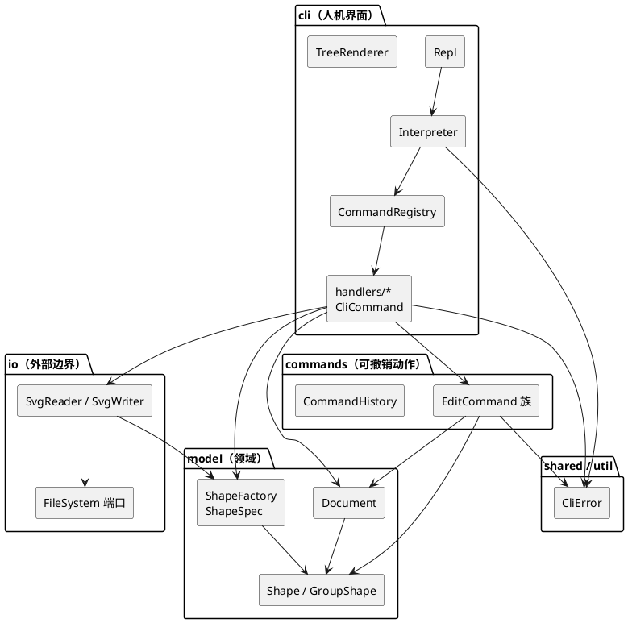

# Lab1 Phase 1 — SVG 编辑器（CLI）

TypeScript 实现的命令行 SVG 编辑器。图形以 id 定位，容器与叶子统一操作（Composite），
所有编辑动作都是可撤销的命令对象（Command）。

```bash
npm install
npm run build
npm run cli          # 进入 REPL，提示符 svg>
npm test             # 跑 transcript 回归测试
```

---

## 架构方案

### 1. 模块划分

| 目录 | 职责 | 关键类 |
|---|---|---|
| `src/model/` | 图形模型（Composite 的 Component/Composite）、id 索引与画布状态、图形类型工厂 | `Shape`、`GroupShape`、`RectShape`/`CircleShape`/`EllipseShape`/`LineShape`/`TextShape`、`PaintStyle`、`Document`、`ShapeFactory`、`ShapeSpec` |
| `src/commands/` | 可撤销的编辑动作与 undo/redo 栈（Invoker） | `EditCommand`、`CreateCommand`、`DeleteCommand`、`MoveCommand`、`ScaleCommand`、`SetCommand`、`GroupCommand`、`UngroupCommand`、`AddToCommand`、`ZOrderCommand`、`CommandHistory` |
| `src/io/` | 与外部世界的边界：SVG 序列化/反序列化、文件读写端口 | `SvgReader`、`SvgWriter`、`XmlParser`、`FileSystem`、`NodeFileSystem` |
| `src/cli/` | 人机界面：REPL、命令分派、参数校验、tree/show 渲染 | `Repl`、`Interpreter`、`Session`、`CommandRegistry`、`CliCommand` + `handlers/*`、`TreeRenderer`、`Tokenizer` |
| `src/shared/` | 被多層共用的最小契约（不含业务） | `CliError` |
| `src/util/` | 纯函数工具：数字格式化、XML 转义 | `NumberFormat`、`XmlEscape` |
| `src/test/` | 回归测试（transcript 回放） | `run.ts`、`InMemoryFileSystem` |



### 2. 设计模式的选择

| 模式 | 落地位置 | 解决什么问题 |
|---|---|---|
| **Command**（作业要求） | `EditCommand` 抽象基类 + 10 个具体命令；`CommandHistory` 持有 undo/redo 栈 | 一条编辑命令 = 一个 undo 单元。命令自带"落点信息"（原父容器 + 原索引 / 旧属性值），undo 不需要对整个文档做快照；redo 栈在新编辑时清空；文档类命令后上锁 |
| **Composite** | `Shape`（Component）/ `GroupShape`（Composite，含 type='svg' 的根）/ 五种叶子 | `move`/`scale`/`delete`/`set` 对 `<g>` 与叶子一视同仁：容器把调用递归到子孙，命令层不写 `if (isContainer)` 分支 |
| **工厂方法 / 注册表（OCP 插槽）** | `ShapeSpec`（Creator）+ `ShapeFactory` | 类型名 → 构造逻辑集中在一处；新增类型只需 `factory.register(new BoxSpec())`，内核代码零改动（这是下一阶段插件化 `box` 的落点） |
| **策略（属性语义）** | `PaintStyle` 组合进 `Shape` | fill/stroke/stroke-width 的读写、序列化、回显集中一处，六种子类复用 |
| **端口与适配器（依赖倒置）** | `FileSystem` 接口 + `NodeFileSystem` 实现 | IO 隔离：唯一接触磁盘的是 `NodeFileSystem`；测试换成 `InMemoryFileSystem` 即可断言 save 的内容 |
| **注册表分派（受限使用）** | `CommandRegistry`（命令名→处理器）、`ShapeFactory`（类型名→Spec） | 按名字分派只出现在两处，已在下文"依赖方向规则"中标注为待重构项 |

### 3. 依赖方向规则

> 箭头 = "可以 import"。**反向依赖即为待处理项**。

| 模块 | 允许依赖 | 理由 |
|---|---|---|
| `util` / `shared` | 无（只依赖标准库） | 纯工具与最小契约，谁都可以用 |
| `model` | `util`、`shared` | 领域层必须不知道界面、命令、文件格式；否则换个通道（GUI/agent）就得改模型 |
| `commands` | `model`、`shared`、`util` | 命令是对模型的变更，只应认识模型 |
| `io` | `model`、`util` | 序列化需要按类型构造图形，但不该知道命令与界面 |
| `cli` | `commands`、`model`、`io`、`shared`、`util` | 界面是组装层：把输入翻译成命令、把模型渲染成文本 |

**禁止**：`model → cli / commands / io`；`commands → cli / io`；`io → cli / commands`。
（自检方式见"一致性自查"。）

### 4. 变化点假设

| # | 我认为最可能变的地方 | 留了什么 / 为什么决定不留 |
|---|---|---|
| 1 | **新增图形类型**（下阶段的 `box`，或 path/polygon） | **留了**：`ShapeFactory.register(ShapeSpec)` 插槽 + `data-kind` 序列化标记 + `tree` 的类型标注（`g#n1 (box)`）。新增类型时 `commands`/`cli` 不需要改一行 |
| 2 | **新增 / 修改命令** | **留了**：`CommandRegistry` + `CliCommand` 三件套（name/usage/description），`help` 自动列出新命令。**没留**：通用参数解析器（命令行语法各异，硬编码 switch 反而更少）——本期命令表固定，收益不抵复杂度 |
| 3 | **持久化格式**（换成 JSON、或要保留未知 SVG 属性） | **半留**：读写全部集中在 `io/`，`Document` 不知道格式；未知属性存进 `Shape.extraAttributes()` 并在写出时还原，保证 round-trip 无损。**没留**：`Serializer` 抽象接口——目前只有一种格式，过早抽象 |
| 4 | **交互通道**（GUI / agent 直接调用） | **留了**：命令语义在 `commands/`，`Repl` 只负责读行打印；GUI 事件可以直接 new 一个 `EditCommand` 交给 `CommandHistory`，完全绕过 `cli` |
| 5 | **属性集合扩大**（更多几何/样式属性） | **半留**：外观属性集中在 `PaintStyle`（加一个 case 即可）；各类型的几何属性仍是子类里的数组+switch——类型固定，抽象出"属性描述表"目前只会增加间接层 |
| 6 | **变换语义**（现在 move/scale 是直接把数值烘焙进几何属性） | **不留**：改为写 `transform` 属性会让 `tree`/`show` 读到的坐标与最终渲染不一致，调试成本高；烘焙保证"所见即所存"。若将来要支持旋转/倾斜，这是一处需要重写的点，已在变化点清单里登记 |

---

## 过程记录

与 AI 协作过程中几个关键判断与被纠正的错误：

1. **tree 缩进多了一层**（真实 bug，被测试抓到）。`TreeRenderer` 初版把根节点也算进前缀缩进，导致 `tree` 的第一层子节点前面多出 4 个空格，与 §5.1 不符。修正为"根不产生缩进段"（`for (…; depth > 1; …)`），并把 §5.1/§6 的完整 transcript 固化成断言，防止回归。
2. **text 内容是子文本而非属性**，因此 XML 转义必须发生在写入时（`escapeXml`）、还原发生在读入时（`unescapeXml`）。第一版 `SvgReader` 忘了还原，round-trip 测试立刻暴露出 `Hello &amp; &lt;World&gt;` 被二次转义；修好后加了"save → read → 再 save，两次文件字节相同"的断言。
3. **`ungroup` 之后容器本身要消失**（不是留下空壳）。实现上先把子节点从容器摘出、再把容器从父级摘出并注销 id，子节点占据容器原来的下标；undo 时反向复原。第一版误以为要保留空 `g`，用 z-order/ungroup 用例的 tree 输出确认了行为。
4. **文档类命令的 undo 语义**：`init/read/save/canvas 改尺寸` 之后选择"清空两个栈 + 上锁"，而不是保留栈。理由是跨文档撤销的语义无法定义（撤销到已不存在的文档），§4.3 也只规定了要报 `undo not allowed after io command`。
5. **undo 没有采用"文档快照"**。AI 最初的方案是每次编辑前深拷贝整份 `Document` 入栈——实现最省事，但会把内存占用与"可撤销次数"绑定，且快照式 undo 会把无关改动一起卷回。改为每个 `EditCommand` 自带逆操作所需的最小落点信息（原父容器 + 原下标 / 旧属性值），`group` 这类多目标命令也只是一个 undo 单元。
6. **"按名字分派"的收敛过程**。初版在 `Interpreter` 里用 `switch (commandName)` 分发命令，等于把分派散在界面层；按 §2.1 的要求收敛到唯一一处 `CommandRegistry`（命令名 → 处理器），图形类型名 → `ShapeSpec` 收敛到 `ShapeFactory`，两者都在架构方案里标注为待重构项。
7. **显示格式对齐规则的确定**。`tree` 的属性列需要对齐，但示例给出的列宽无法用同一条规则复现（§5.1/§6 对齐到第 19 列，§6.1 对齐到第 29 列且 `text#process-label` 一行明显溢出，判断为手工排版）。最终定为**全局单一对齐列**：列号 = 所有带属性行中「前缀长度 + 标签长度」的最大值 + 2，不足时至少留 1 个空格。该规则能逐字节复现 §5.1 与 §6 的完整 transcript（第 19 列），且任意 id 长度下都不会串行。
8. **`line` 在 tree 里只显示端点**。§6.1 的 tree 中 `line#arrow1 (280,130) -> (520,130)` 不带 `stroke`，而 rect/circle 都带 `fill`，因此 `LineShape.summary()` 只输出两个端点，`stroke` 只在 `show` 里出现。

---

## 一致性自查

1. **模块划分**：实际目录与方案一致——`model` / `commands` / `io` / `cli` / `shared` / `util` / `test` 七块，职责与上表逐条对应；没有出现方案里没有的目录，也没有把命令语义塞进 `cli`（`cli/handlers/*` 只做参数校验与组装，变更一律交给 `commands/*`）。
2. **依赖方向**：抽样检查（在 `src` 下按目录 grep 反向 import）：
   - `model`、`shared`、`util` 中没有任何 `../cli`、`../commands`、`../io` 的 import；
   - `commands` 中没有 `../cli`、`../io`；
   - `io` 中没有 `../cli`、`../commands`。
   三条禁止规则均未被违反。"按名字分派"只出现在 `CommandRegistry`（命令名）与 `ShapeFactory`（类型名），已按范式要求标注为待重构项。

> 修订记录：
> 1. 初版把 `copyStyle` 这类跨图形工具函数塞在 `RectShape.ts` 里（违反"一类一文件"），已改为各 `clone()` 内联三行；
> 2. `CliError` 从 `cli/` 移到 `shared/`，否则 `model`/`commands` 会反向依赖 `cli`；
> 3. `src/cli/handlers/` 下 8 个文件的文件名与类名不一致（如 `CreateCommand.ts` 里是 `CreateCommandHandler`），违反 §2.1"文件名 = 类名"，已统一重命名为 `*CommandHandler.ts`。

---

## 质量保证手段

1. **transcript 回归测试**（`npm test`，12 组断言、全部通过）。把 spec 里的会话直接固化成期望输出：
   - §6 完整 transcript（含 `save`/`read` 后的 id 自动补警告、undo 被 io 锁拒绝）；
   - §6.1 两节点流程图（`in` 子句自顶向下构建、容器整体平移）；
   - §4.2 错误信息表**逐条**（id 重复 / 无此图形 / 无此容器 / 不是容器 / 未知类型 / 缩放非正 / 未知属性 / 读文件失败 / 根级容器 ungroup / 环检测）；
   - §5.2 `show` 格式；Composite 语义（容器 `scale` 递归、`delete` 级联、undo 复位）；
   - round-trip：`save → read → save` 两次文件字节一致，且文本实体正确还原；
   - z-order 前后位置、`ungroup`、`redo` 栈被新编辑清空。
2. **编译器当静态检查用**：`tsconfig` 开 `strict` + `noImplicitOverride` + `noUnusedLocals` + `noUnusedParameters`，零警告通过；`noImplicitOverride` 保证子类"忘了写 override"会报错，避免重写未生效。
3. **IO 隔离带来的可测性**：`FileSystem` 端口让测试完全不碰磁盘，能直接断言序列化结果，也让"文件不可读/不可写"的分支可以被稳定触发。
4. **人工验收**：`npm run cli` 手跑 spec §0 的最小例子，`save demo.svg` 后用浏览器打开确认渲染；`help` 输出与命令表逐条核对。
5. **已知未覆盖**：复合图形 `box`（插件化阶段目标，本阶段 `create box` 正确报 `unknown shape type`）；XPath 式结构路径寻址（本阶段不要求）。

---

## 附：与任务书的逐条对照

| 任务书条款 | 结论 |
|---|---|
| §2 通用约定（提示符 `svg>`、`#` 注释、id 定位、缺 id 自动补并警告、坐标系、双引号、`error:` 前缀、成功回显） | 全部实现。"失败不改状态"已固化成测试：一串失败命令之后 `tree` 不变、`read` 失败后原文档保持 |
| §2.1 范式（TS+OOP、一类一文件、禁止贫血模型、按名字分派只允许两处、容器与叶子统一操作） | 全部满足。按名字分派只有 `CommandRegistry`（命令名）与 `ShapeFactory`（类型名）两处，已标注为待重构 |
| §3 命令总表 | 20 条全部实现。额外多出 `exit` / `quit` 两个 REPL 退出命令（不参与作业命令表，已在 help 列出） |
| §4.1 六种类型、`in` 子句、`set` 白名单、fill/stroke 省略不写 | 全部实现。`create box` 正确报 `unknown shape type` |
| §4.2 错误信息表 | 表中 11 条全部实现 |
| §4.3 undo/redo 粒度、文档类命令后禁止 | 全部实现 |
| §4.4 复合图形 box | 本阶段不要求，未实现；已预留 `ShapeFactory.register` 与 `data-kind` 两个口子 |
| §5 显示格式 | tree / show 结构、缩进、属性内联与 §5.1/§5.2/§6/§6.1 示例一致 |
| §1.1 代码（git） | 分层提交（8 次）+ `final` tag，已推送远程仓库 |
| §1.2 文档 | `doc/README.md`，含架构方案四节 + 过程记录 + 一致性自查 + 质量保证 |

---

## 与本阶段无关但已预留的口子

- `ShapeFactory.register()`：插件化阶段注册 `box` 的入口；
- `Shape.extraAttributes()`：`data-kind="box"` 的读回还原（未注册该插件时降级为普通 `g`）；
- `TreeRenderer` 的类型标注：读到 `data-kind` 就显示 `g#n1 (box)`。
